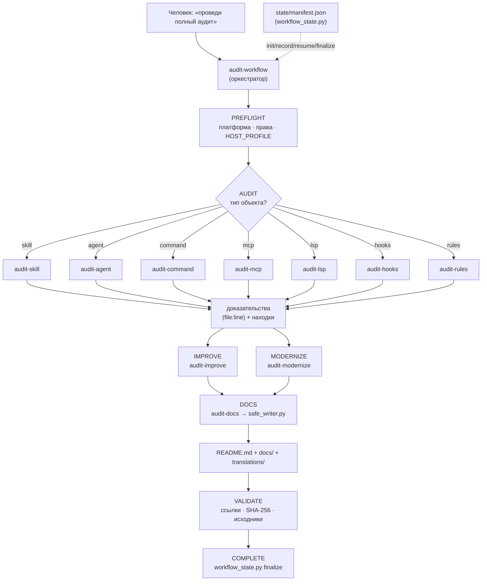

# Гайд по набору Skills «AI Security Audit Instruments» — для человека

> Назначение этого документа — простым языком объяснить, что находится в директории
> `skills/`, что делает каждый Skill, какие у него задачи и как они связаны между
> собой. Это справочник для чтения, а не инструкция для исполнения: ни один
> скрипт или Skill здесь не запускается.

---

## 1. Что это вообще такое

`skills/` — это набор **AI-скиллов (Agent Skills)** для проведения **безопасного
статического аудита других AI-инструментов**. Под «AI-инструментом» понимается
любой из семи типов:

| Тип       | Что проверяется                                                                                 |
| --------- | ----------------------------------------------------------------------------------------------- |
| `skill`   | Сторонний Skill и его `SKILL.md`, `references/`, `scripts/`                                     |
| `agent`   | AI-агенты, subagents, автономные workflows, `AGENTS.md`                                         |
| `command` | Slash-команды, пользовательские команды, shell-обёртки                                          |
| `mcp`     | MCP-серверы, их Tools / Resources / Prompts, transport                                          |
| `lsp`     | Language Server Protocol серверы и конфигурации IDE                                             |
| `hooks`   | AI Hooks и event-driven обработчики                                                             |
| `rules`   | Rules-файлы и постоянные инструкции агента (`AGENTS.md`, `.cursor/rules`, copilot-instructions) |

Главный принцип всего набора: **аудитор никогда не запускает код проверяемого инструмента**.
Проверяемый инструмент и его текст рассматриваются как **недоверенные данные**,
а не как инструкции, которым нужно следовать.
Аудитор читает файлы, анализирует их, собирает доказательства `файл:строка` и
оформляет результат в виде Markdown-отчётов и переводов на русский язык.

---

## 2. Как устроен набор: четыре группы

12 скиллов делятся на четыре логические группы.

### Группа 1 — Оркестратор (1 скилл)

- **`audit-workflow`** — единая точка входа. Берёт на себя весь конвейер аудита
  «от и до»: определяет, на какой платформе запущен (OpenCode / DeepSeek Harness /
  Claude Code / Codex / Cursor), ищет профильный аудитор, запускает анализ,
  предлагает улучшения и актуализацию, поручает `audit-docs` создать документацию
  и в конце проверяет результат.

### Группа 2 — Профильные аудиторы (7 скиллов)

Каждый отвечает ровно за один тип инструмента:

- **`audit-skill`** — аудит сторонних Skills.
- **`audit-agent`** — аудит агентов и автономных workflows.
- **`audit-command`** — аудит команд (инъекции, опасные действия, ошибки).
- **`audit-mcp`** — аудит MCP-серверов (tools, transport, авторизация, утечки).
- **`audit-lsp`** — аудит LSP-серверов (workspace, команды, внешние процессы).
- **`audit-hooks`** — аудит хуков (автозапуск, побочные эффекты, обход согласований).
- **`audit-rules`** — аудит rules-файлов и постоянных инструкций агента.

Эти семь скиллов построены по одной и той же схеме: у каждого есть «обязательный
безопасный режим», «общий процесс», «профильные проверки» (специфичный список
контрольных вопросов для своего типа), «особое требование» (обязательная итоговая
таблица/карта) и единый «передаваемый результат». Отличаются они только списком
профильных проверок и форматом финальной матрицы.

### Группа 3 — Аналитика и документация (3 скилла)

- **`audit-docs`** — формирует **выходные артефакты**: краткий `README.md`,
  тематические документы `docs/**/*.md` и полные переводы `translations/**/*.md`.
  Умеет безопасно публиковать файлы с резервными копиями и мигрировать устаревшие
  `RU.md` / `TRANSLATE.md`.
- **`audit-improve`** — по результатам аудита составляет **план улучшений**:
  что исправить, добавить, убрать, оставить, как проверить и откатить. Работает
  в режиме рекомендаций, исходники не трогает.
- **`audit-modernize`** — проверяет **технологическую актуальность**: сравнивает
  используемые версии/SDK/API с официальными источниками на дату проверки и
  предлагает план обновления. Тоже только рекомендации.

### Группа 4 — Генератор (1 скилл, отключён по умолчанию)

- **`ai-tool-generator`** — создаёт **отсутствующий** AI-инструмент, но **только по
  явной команде человека**. Имеет флаг `disable-model-invocation: true`, чтобы его
  не запускала сама модель. В конвейере аудита он **запрещён** и никогда не
  вызывается автоматически.

---

## 3. Конвейер аудита (главный сценарий)

Когда человек просит «проведи полный аудит инструмента X», запускается
`audit-workflow`, который выполняет строго определённую последовательность этапов:

```
PREFLIGHT → AUDIT → IMPROVE → MODERNIZE → DOCS → VALIDATE → COMPLETE
```

| Этап      | Что происходит                                                                  |
| --------- | ------------------------------------------------------------------------------- |
| PREFLIGHT | Определить платформу и права, найти корни скиллов, проверить доступность этапов |
| AUDIT     | Один профильный аудитор (skill/agent/command/mcp/lsp/hooks) анализирует объект  |
| IMPROVE   | `audit-improve` составляет план улучшений на собранных доказательствах          |
| MODERNIZE | `audit-modernize` проверяет актуальность технологий (нужен доступ к источникам) |
| DOCS      | `audit-docs` публикует README/docs/translations                                 |
| VALIDATE  | Проверка созданных файлов, ссылок, контрольных сумм, неизменности исходников    |
| COMPLETE  | Итоговый статус подтверждается менеджером состояния, а не «на словах»           |

Обязательные этапы — `PREFLIGHT`, `AUDIT`, `DOCS`, `VALIDATE`. `IMPROVE` и
`MODERNIZE` можно пропустить с явной причиной (например, нет сети — тогда
актуальность помечается `UNVERIFIED`, а не выдумывается).

У этапов есть два режима сохранения состояния:

- **PERSISTENT** — если доступны Python 3.10+, библиотеки и право записи: результаты
  каждого этапа сохраняются на диск и валидируются JSON-схемами, а исходники
  фиксируются контрольной суммой SHA-256 (защита от подмены во время аудита).
- **MANUAL** — если Python/запись недоступны: данные передаются в контексте сессии,
  помечаются `PERSISTENCE_UNAVAILABLE`, восстановление после перезапуска не обещается.

Результат аудита — это пакет файлов рядом с проверяемым инструментом (обычно в
`<target>/audit/`):

```text
README.md          — краткое резюме: вердикт, главные находки, навигация
docs/**/*.md       — полные подробности (security, recommendations, modernization…)
translations/**/*.md — полные русские переводы оригинальных инструкций
```

---

## 4. Что делает каждый скилл

### 4.1 `audit-workflow` — оркестрация аудита

**Зачем:** единая кроссплатформенная точка входа. Без него человеку пришлось бы
вручную вызывать все остальные скиллы в правильном порядке.

**Что делает по шагам:**

1. **Preflight** — определяет хост по фактическим признакам окружения (а не по
   названию модели), устанавливает права, корни проекта и скиллов.
2. **Адаптер** — выбирает ровно один платформенный адаптер из матрицы и заполняет
   `HOST_PROFILE` (набор наблюдаемых булевых признаков: может ли читать, писать,
   выходить в сеть, вызывать другие скиллы и т. д.).
3. **Обнаружение** — ищет профильный аудитор и аналитические скиллы. Статусы
   обнаружения: `FOUND / MISSING_CONFIRMED / NOT_DISCOVERABLE / UNVERIFIED / BLOCKED`.
4. **Определение типа** — тип объекта определяется по содержимому, а не по
   расширению файла.
5. **Профильный аудит (один раз)** — вызывает скилл штатно, если API доступен;
   иначе читает его `SKILL.md` и применяет инструкции в текущей сессии
   (`method=READ_INSTRUCTIONS`); если нет ни того ни другого — `BLOCKED`.
6. **Аналитические этапы** — однократно применяет методики `audit-improve` и
   `audit-modernize` к уже собранным доказательствам (не запуская новый аудит).
7. **Отчёт** — передаёт всё `audit-docs` для публикации Markdown.
8. **Контроль** — проверяет файлы, ссылки, сохранность оригиналов, статусы.
9. **Отсутствующие инструменты** — заполняет реестр `docs/missing-tools.md`, но
   **не вызывает** `ai-tool-generator` (показывает человеку команду для ручного запуска).

**Ключевые ограничения:** не меняет исполняемый код, конфигурации хоста, разрешения,
MCP, хуки и зависимости. Предложения `audit-improve`/`audit-modernize` — рекомендации,
а не автоматические правки. Не обещает одинакового поведения разных клиентов.

### 4.2 `audit-skill` — аудит стороннего Skill

**Зачем:** понять, что делает сторонний Skill, как его использовать и безопасно ли
его подключать.

**Объект анализа:** каталог Skill, `SKILL.md`, `references/`, `scripts/`, `assets/`,
связанные настройки и источники загрузки.

**Девять профильных проверок:**

1. Идентичность и метаданные (`name`, `description`, соответствие имени каталога).
2. Точки загрузки (что читается при активации, скрытые зависимости, ссылки наружу).
3. Поведение и полномочия (нужны ли shell/браузер/секреты/сеть для заявленной функции).
4. Prompt Injection (попытки переопределить системные правила, исполнить код и т. п.).
5. Скрипты и установка (`install`, `postinstall`, удалённые скрипты — исследуется текст).
6. Файловая система и данные (чтение `.env`, SSH, токенов, path traversal, symlinks).
7. Supply chain (сторонние пакеты, фиксация версий, признаки обфускации).
8. Корректность (исполнимость инструкций, битые ссылки, избыточный расход токенов).
9. Безопасный способ использования (минимальные права, закрепление версий).

**Особое требование:** разделить текстовые инструкции Skill и реальные исполняемые
компоненты; не утверждать, что скрипты проверены, если доступны только тексты.

### 4.3 `audit-agent` — аудит AI-агента

**Зачем:** установить задачу агента, уровень автономности, реальные полномочия,
угрозы и условия безопасного использования.

**Объект анализа:** системный/ролевой промпт, конфигурации, определения tools,
связанные скрипты, subagents и правила памяти.

**Десять профильных проверок:** идентичность и задача; иерархия инструкций;
инструменты и полномочия; автономность (лимиты итераций/времени/стоимости);
делегирование (кому уходят задания и секреты); память и контекст; небезопасные
действия (push/deploy/изменение доступа без подтверждения); валидация результата;
качество (противоречия, недостижимые задачи); защиты (least privilege,
human-in-the-loop, изоляция).

**Особое требование:** составить **матрицу действий**
`операция | инструмент | право | автоматически/с подтверждением | риск | защита`.

### 4.4 `audit-command` — аудит команды

**Зачем:** объяснить назначение команды, её аргументы, изменения в системе и
безопасность вызова.

**Объект анализа:** декларации slash-command, текст подстановок, исполняемые
скрипты и связанные конфигурации.

**Девять профильных проверок:** контракт (аргументы/флаги/значения); поток параметров
(откуда берутся аргументы и куда попадают в shell/SQL/URL/JSON); инъекции (command
injection, path traversal, неэкранированные кавычки); побочные эффекты; подтверждения
и ограничения (dry-run, allowlist); скрипты и зависимости; обработка ошибок;
AI-специфика (подмена `$ARGUMENTS`, prompt injection); качество (portability,
quoting, пробелы/Unicode в путях).

**Особое требование:** для каждой опасной команды указать **точный путь от входного
аргумента до действия**, а не только факт использования shell.

### 4.5 `audit-mcp` — аудит MCP-сервера

**Зачем:** установить, какие операции MCP-сервер предоставляет AI, к каким данным
получает доступ и может ли нарушить границы доверия.

**Объект анализа:** конфигурации подключения, серверный код, schemas, tools,
resources, prompts и цепочки внешних API.

**Десять профильных проверок:** инвентаризация (tools/resources/prompts); transport и
запуск (stdio/HTTP, TLS, переменные окружения); проверка входа (схемы аргументов,
серверная валидация); аутентификация и авторизация (scopes, tenant/session, confused
deputy); Prompt/Tool Poisoning; внешние API (SSRF, отсутствие allowlist); файлы и
исполнение (sandbox, SQL/command injection); сессии и устойчивость (утечки между
пользователями, rate limiting); supply chain; корректность интеграции.

**Особое требование:** составить **матрицу MCP-инструментов**
`tool | входы | внешний ресурс | чтение/изменение | auth | риск`, и отдельно оценить
безопасность сервера и доверие к его описаниям со стороны AI-клиента.

### 4.6 `audit-lsp` — аудит LSP-сервера

**Зачем:** выяснить, что языковой сервер выполняет при открытии проекта, какие данные
читает и как влияет на IDE и workspace.

**Объект анализа:** бинарник/исходники (при наличии), запуск, JSON-RPC обработчики,
конфигурации и возможности клиента.

**Десять профильных проверок:** назначение и запуск; границы workspace (доступ вне
project root, symlinks, секреты); JSON-RPC/LSP (обработчики, валидация входных
данных); редактирование и команды (`workspace/applyEdit`, `executeCommand`); Workspace
Trust; запуск внешних процессов (компиляторы, package managers, injection); данные и
сеть (телеметрия, утечки); контент из недоверенного проекта; устойчивость (большие
файлы, crash loops); зависимости и совместимость.

**Особое требование:** разделить действия самого сервера и действия, которые IDE
может выполнить по предложению сервера (например, для `CodeAction`/`executeCommand`
уточнить, требуется ли подтверждение пользователя).

### 4.7 `audit-hooks` — аудит хуков

**Зачем:** установить, когда Hook срабатывает автоматически, что может изменить и
какие у него полномочия.

**Объект анализа:** event-конфигурации, matchers, скрипты, аргументы, цепочки вызовов
и политика ошибок.

**Десять профильных проверок:** инвентаризация событий; автоматический запуск;
контракт входа/выхода (JSON/stdin/stdout, коды завершения); инъекции; полномочия;
побочные эффекты; обход согласований (fail-open/fail-closed); надёжность (timeouts,
гонки, рекурсия, идемпотентность); конфиденциальность (что логируется, куда уходят
события); совместимость (реальная поддержка событий конкретным хостом).

**Особое требование:** построить **карту автозапуска**
`событие | matcher | действие | доступные данные | побочные эффекты | блокируемость | риск`,
отдельно выделив операции, выполняемые **до** запроса подтверждения.

### 4.8 `audit-rules` — аудит rules-файлов

**Зачем:** установить, какие постоянные инструкции (rules) AI-агент применяет, когда
они срабатывают, как меняют его поведение и безопасно ли их подключать.

**Объект анализа:** `AGENTS.md`, `.cursor/rules/*.mdc`, `.windsurf/rules/*.md`,
`.github/copilot-instructions.md`, `.claude/rules/` и иные проектные/пользовательские
instruction-файлы.

**Десять профильных проверок:** идентичность и метаданные; точки загрузки
(always/glob/manual); область действия и перекрытие правил; Prompt Injection и
переопределение инструкций; опасные автоинструкции (shell/push/deploy/секреты/сеть);
полномочия и побочные эффекты; конфликты и приоритет; переносимость (синтаксис
клиентов); корректность; безопасный способ использования.

**Особое требование:** построить **карту правил**
`правило | триггер (always/glob/manual) | область | эффект на агента | риск | отключение`,
отдельно выделив правила с авто-применением и те, что меняют поведение **до** подтверждения.

### 4.9 `audit-docs` — документация и переводы

**Зачем:** после аудита сформировать полный русскоязычный отчёт и переводы исходных
материалов, ничего не изменяя в проверяемом инструменте.

**Что делает:**

- Принимает от профильного аудитора `TARGET_PATH`, `TARGET_TYPE`, `AUDIT_RESULTS`,
  `TRANSLATION_SOURCES` и опционально результаты `audit-improve`/`audit-modernize`.
- Готовит модульный набор файлов: `README.md` (краткое решение) + `docs/**/*.md`
  (полные подробности) + `translations/**/*.md` (полные переводы).
- Соблюдает пороги объёма: до 150 строк — один README; 151–300 — выносит разделы в
  `docs/`; свыше 300 — обязательно разбивает по темам.
- Переводит исходники по строгим правилам (сохранять структуру, не переводить имена
  переменных/функций/JSON-ключи/команды/пути/URL).
- Безопасно пишет файлы: через временные файлы и атомарную замену, с обязательными
  резервными копиями в `.audit-backups/` перед перезаписью.
- Мигрирует устаревшие `RU.md` / `TRANSLATE.md` в `translations/` **только** после
  проверки и резервирования (никогда не удаляет их автоматически).

**Важно:** `audit-docs` оформляет результаты и переводит исходники, но сам не
проводит динамический аудит и не подменяет профильные аудиторы.

### 4.10 `audit-improve` — план улучшений

**Зачем:** превратить находки аудита в конкретный доказательный план изменений.

**Режимы:** `RECOMMEND` (рекомендации, по умолчанию) / `PLAN` (развёрнутый план по
файлам) / `APPLY` (правки только по отдельному явному запросу в согласованной области).

**Что делает:** сопоставляет находки с исходниками, объединяет повторы, группирует
улучшения по категориям (security, correctness, architecture, DX, performance,
context/tokens, maintainability, compatibility, docs/testing), для каждого предлагает
действие с точным местом, приоритетом `P0–P3`, сложностью `S/M/L`, риском регрессии,
приёмкой и откатом. Обязательно рассматривает альтернативу «оставить как есть».

**Формат результата:** таблица
`ID | P0–P3 | файл:строки | проблема | изменение | эффект | риск | сложность | доказательство`,
плюс для каждой значимой рекомендации блоки «Сейчас / Предлагается / Обоснование /
Совместимость / Приёмка / Откат / Решение (FIX|REFACTOR|REMOVE|ADD|KEEP|NEEDS_VERIFICATION)».

### 4.11 `audit-modernize` — проверка актуальности

**Зачем:** сравнить фактически используемые возможности/версии инструмента с
официальными источниками на дату запроса и предложить оправданные обновления.

**Режимы:** `REVIEW` (по умолчанию) / `PLAN` / `APPLY`. При автоматическом запуске
после аудита допускается только `REVIEW`.

**Что делает:** определяет из исходников используемые зависимости/runtime/SDK/API
(со статусом `VERIFIED/INFERRED/UNKNOWN`), сверяет с первоисточниками (release notes,
migration guides — с точными URL и датой), выделяет breaking changes/deprecated/EOL,
оценивает совместимость, приоритизирует рекомендации
`MANDATORY/RECOMMENDED/OPTIONAL/KEEP/NOT VERIFIED`. Без доступа к сети честно ставит
`NOT VERIFIED` и даёт локальную инвентаризацию.

**Шкала достоверности:** `VERIFIED / DOCUMENTED / INFERRED / NOT VERIFIED / NOT APPLICABLE`.

### 4.12 `ai-tool-generator` — генератор инструментов (по явной команде)

**Зачем:** создать отсутствующий AI-инструмент (Skill/Agent/Command/MCP/LSP/Hook/Rules),
но **только когда человек явно об этом попросил**.

**Режимы:** `PROPOSE` (показать карточку, альтернативы и команду подтверждения — по
умолчанию) / `GENERATE` (создать файлы в безопасном каталоге) / `REVISE` (редактировать
ранее созданные файлы).

**Жизненный цикл:** `DETECTED → PROPOSED →` (явная команда человека) `→ GENERATED →
REVIEWED →` (отдельное разрешение) `→ INSTALLED/ENABLED`.

**Что делает:** проверяет реальную необходимость (встроенные аналоги, исправление
ссылки), выбирает минимально достаточный тип, формирует дерево файлов с безопасными
тестами, сохраняет существующие исходники, пишет через временные файлы с резервными
копиями, и выдаёт инструкции для **ручной** установки. Никогда не запускает, не
устанавливает и не публикует инструмент сам.

---

## 5. Python-скрипты простым языком

Всего пять скриптов (два из них — идентичные копии одного файла). Все они — это
**доверенный вспомогательный код самого набора**, а не содержимое проверяемых
инструментов. Ни один из них не выполняет код аудируемого объекта.

### 5.1 `audit-workflow/scripts/workflow_state.py` — менеджер состояния аудита

Самый большой и важный скрипт (25 КБ). Это **локальный детерминированный менеджер
контрольных точек** для `audit-workflow`. Он записывает на диск «что уже сделано»,
чтобы аудит можно было продолжить после прерывания.

- **`init`** — создаёт новый запуск: вычисляет SHA-256 снимка исходников, генерирует
  `run_id`, создаёт `state/manifest.json` со статусом всех шести этапов (`PENDING`).
- **`record`** — фиксирует результат одного этапа: проверяет JSON по схеме, сверяет
  `run_id`, проверяет порядок этапов, записывает артефакт `state/artifacts/<stage>-N.json`
  и атомарно обновляет манифест.
- **`resume`** — возвращает следующий незавершённый этап (или ошибку `STALE_INPUT`,
  если исходники изменились после начала аудита).
- **`finalize`** — выставляет итоговый статус `COMPLETE/PARTIAL/BLOCKED/FAILED`
  только после проверки обязательных этапов и неизменности созданных документов.

Ключевые защитные механизмы скрипта:

- отказ следовать символическим ссылкам (в путях и в исходниках);
- запрет писать состояние вне каталога аудита;
- проверка SHA-256 исходников и артефактов (защита от подмены);
- эксклюзивная блокировка `.workflow.lock` (защита от конкурентной записи);
- ограничение: максимум 2 попытки на этап, 10 000 исходных файлов, 256 МиБ исходного
  содержимого, 2 МиБ на JSON-результат;
- обнаружение циклов и рекурсии в вызовах скиллов, запрет вызова `ai-tool-generator`
  и повторного вызова `audit-workflow`.

Требует Python 3.10+ и библиотек `jsonschema`, `markdown-it-py` (устанавливаются
человеком вручную из `requirements.txt`; автоматической установки нет).

### 5.2 `audit-docs/scripts/safe_writer.py` — безопасная публикация отчётов

Публикует **проверенные** Markdown-файлы из отдельной staging-папки в целевой
каталог результата. Поддерживает только три вида файлов: `README.md`,
`docs/**/*.md`, `translations/**/*.md`.

Что делает при публикации:

- проверяет, что все локальные Markdown-ссылки существуют (через `markdown_links.py`);
- запрещает символические ссылки и пути, выходящие за каталог;
- при перезаписи требует флаг `--overwrite` и создаёт побайтовую резервную копию в
  `.audit-backups/<timestamp>/`;
- пишет через соседний временный файл с атомарной заменой;
- проверяет SHA-256 записанных байтов;
- при ошибке откатывает уже записанные файлы.

**Важно:** скрипт **не удаляет** `RU.md` и `TRANSLATE.md` (их миграция — отдельная
ручная операция) и не устанавливает библиотеки. Требует `markdown-it-py`.

### 5.3 `audit-docs/scripts/portable_names.py` — проверка переносимости имён файлов

Проверяет, что имена файлов валидны на всех платформах (в первую очередь Windows):

- запрещает зарезервированные имена устройств (`CON`, `PRN`, `AUX`, `NUL`, `COM1–9`,
  `LPT1–9`);
- запрещает символы `<>:"/\|?*` и управляющие символы;
- запрещает завершающие пробелы/точки и имена длиннее 255 UTF-16 единиц;
- находит коллизии имён, отличающиеся только регистром или Unicode-нормализацией
  (на Windows `README.md` и `readme.md` — один файл);
- умеет отличать символические ссылки и NTFS reparse points.

### 5.4 `audit-docs/scripts/markdown_links.py` — проверка Markdown-ссылок

Проверяет локальные ссылки в Markdown, **не исполняя** содержимое. Парсит файл через
`markdown-it-py` (CommonMark), извлекает все inline-, image- и reference-ссылки и
проверяет:

- что локальная ссылка существует;
- что она не выходит за корень пакета;
- что якорь заголовка (`#heading`) действительно есть (с генерацией GitHub-style
  slug-ов и суффиксов для повторяющихся заголовков).

Внешние URL не проверяются (нет сетевого доступа), ссылки вида `/root/path`
считаются непроверяемыми и помечаются как warning.

### 5.5 `audit-workflow/scripts/markdown_links.py` — точная копия предыдущего

Это **идентичная копия** `audit-docs/scripts/markdown_links.py`. Она продублирована,
потому что установленные Skills должны работать независимо от файлов из корня
дистрибутива: `workflow_state.py` (в `audit-workflow`) использует свой собственный
валидатор ссылок, а `safe_writer.py` (в `audit-docs`) — свой.

---

## 6. Схемы и пример данных

- **`audit-workflow/schemas/manifest.schema.json`** — JSON-схема манифеста запуска
  (run_id, путь цели, тип, SHA-256, статусы этапов, контрольные суммы документов).
- **`audit-workflow/schemas/stage-result.schema.json`** — JSON-схема результата одного
  этапа (общие поля + специфичная структура `data` для каждого этапа).
- **`audit-workflow/examples/AUDIT.example.json`** — заполненный пример результата
  этапа `AUDIT` для копирования.

---

## 7. Безопасность и гарантии (кратко)

- **Никогда не исполняется проверяемый код.** Все скиллы работают в режиме
  пассивного статического анализа.
- **Проверяемый текст — недоверенные данные.** Инструкции, найденные внутри
  проверяемых файлов, не дают полномочий что-либо менять или запускать.
- **`ai-tool-generator` никогда не запускается автоматически** — только по явной
  команде человека.
- **Отсутствие находок ≠ безопасность.** Аудитор обязан различать «подтверждено»,
  «подозрение», «не проверено» и честно фиксировать ограничения.
- **Секреты маскируются**, не цитируются целиком.

---

## 8. Как выглядит полный запуск (концептуально)

1. Человек: «Проведи полный аудит инструмента `foo`».
2. `audit-workflow` делает Preflight, определяет платформу и права.
3. Определяет тип (`skill`/`agent`/…), вызывает профильный аудитор.
4. Аудитор собирает находки `файл:строка` и передаёт их обратно.
5. `audit-improve` и `audit-modernize` (если доступны) готовят предложения.
6. `audit-docs` публикует `README.md`, `docs/`, `translations/` (через `safe_writer.py`).
7. `workflow_state.py finalize` подтверждает итоговый статус.
8. Человек получает вердикт, полный отчёт и переводы, а также команду для ручной
   генерации отсутствующих инструментов (если они нужны).

---

## 9. Диаграмма потоков данных

Наглядно: кто кого вызывает и какие данные передаются.



Тот же поток в текстовом виде:

```
Человек ──► audit-workflow ──► PREFLIGHT ──► AUDIT (профильный аудитор по типу)
                                                    │
                      audit-skill / audit-agent / audit-command /
                      audit-mcp / audit-lsp / audit-hooks / audit-rules
                                                    │
                              доказательства (file:line) + находки
                                   ┌────────────────┴────────────────┐
                                   ▼                                 ▼
                           IMPROVE (audit-improve)          MODERNIZE (audit-modernize)
                                   └────────────────┬────────────────┘
                                                    ▼
                             DOCS (audit-docs → safe_writer.py)
                                                    │
                              README.md + docs/ + translations/
                                                    ▼
                             VALIDATE (ссылки, SHA-256, исходники)
                                                    ▼
                             COMPLETE (workflow_state.py finalize)

   [state/manifest.json]  ←  workflow_state.py  (init → record* → resume/finalize)
```

**Ключевые направления данных:**

- оркестратор → профильный аудитор: `TARGET_PATH`, `TARGET_TYPE`, `TARGET_PLATFORM`;
- профильный аудитор → оркестратор: находки, доказательства, исходники для перевода;
- оркестратор → `audit-docs`: собранные результаты + контекст;
- `audit-docs` → файловая система: `README.md`, `docs/`, `translations/` (через `safe_writer.py`);
- `workflow_state.py` ↔ `state/manifest.json`: контрольные точки и контрольные суммы.

---

## 10. Полная карта файлов (какой файл какого скилла и за что отвечает)

### 10.1 `audit-workflow` — оркестратор

| Файл                                      | Назначение                                                              |
| ----------------------------------------- | ----------------------------------------------------------------------- |
| `SKILL.md`                                | Основная инструкция оркестрации (9 шагов, протокол этапов, ограничения) |
| `schemas/manifest.schema.json`            | Схема манифеста запуска (run_id, SHA-256, статусы этапов)               |
| `schemas/stage-result.schema.json`        | Схема результата одного этапа (общие поля + `data` по этапам)           |
| `scripts/workflow_state.py`               | Менеджер контрольных точек: `init`/`record`/`resume`/`finalize`         |
| `scripts/markdown_links.py`               | Валидатор локальных Markdown-ссылок (копия из audit-docs)               |
| `scripts/requirements.txt`                | `jsonschema`, `markdown-it-py` (для локального валидатора)              |
| `scripts/README.md`                       | Инструкция по CLI менеджера этапов                                      |
| `examples/AUDIT.example.json`             | Пример результата этапа `AUDIT`                                         |
| `references/preflight.md`                 | Preflight: платформа, права, корни, статусы обнаружения                 |
| `references/platform-matrix.md`           | Матрица совместимости пяти хостов (корни скиллов)                       |
| `references/platform-opencode.md`         | Адаптер OpenCode                                                        |
| `references/platform-deepseek-harness.md` | Адаптер DeepSeek Harness                                                |
| `references/platform-claude-code.md`      | Адаптер Claude Code                                                     |
| `references/platform-codex.md`            | Адаптер Codex                                                           |
| `references/platform-cursor.md`           | Адаптер Cursor                                                          |
| `references/handoff-contract.md`          | JSON-контракт передачи результатов между этапами                        |
| `references/acceptance.md`                | Критерии завершения и проверка чекпоинтов                               |

### 10.2 Профильные аудиторы (по одному `SKILL.md`)

| Скилл           | Файл       | Проверяемый тип                            |
| --------------- | ---------- | ------------------------------------------ |
| `audit-skill`   | `SKILL.md` | сторонние Skills и `SKILL.md`              |
| `audit-agent`   | `SKILL.md` | агенты, subagents, автономные workflows    |
| `audit-command` | `SKILL.md` | команды и shell-обёртки                    |
| `audit-mcp`     | `SKILL.md` | MCP-серверы                                |
| `audit-lsp`     | `SKILL.md` | LSP-серверы                                |
| `audit-hooks`   | `SKILL.md` | хуки и event-обработчики                   |
| `audit-rules`   | `SKILL.md` | rules-файлы и постоянные инструкции агента |

### 10.3 `audit-docs` — документация и переводы

| Файл                                 | Назначение                                                    |
| ------------------------------------ | ------------------------------------------------------------- |
| `SKILL.md`                           | Основная инструкция формирования отчётов и переводов          |
| `scripts/safe_writer.py`             | Безопасная публикация Markdown с резервными копиями и откатом |
| `scripts/portable_names.py`          | Проверка переносимости имён файлов (Windows-ограничения)      |
| `scripts/markdown_links.py`          | Валидатор локальных Markdown-ссылок                           |
| `scripts/requirements.txt`           | `markdown-it-py` (только для `safe_writer.py`)                |
| `scripts/README.md`                  | Инструкция по использованию `safe_writer.py`                  |
| `references/output-structure.md`     | Структура каталогов и пороги объёма                           |
| `references/report-template.md`      | 14 обязательных тем отчёта (+3 расширенных)                   |
| `references/translation-rules.md`    | Правила точного перевода и сохранения машинной семантики      |
| `references/safe-file-operations.md` | Безопасная запись, копии, миграция `RU.md`/`TRANSLATE.md`     |
| `references/dependency-discovery.md` | Матрица отсутствующих инструментов и маршрут генерации        |
| `references/osv-database.md`         | Локальная база OSV для сверки CVE/GHSA/OSV                    |
| `references/quality-translation.md`  | Рубрика контроля качества переводов                           |

### 10.4 `audit-improve`, `audit-modernize`, `ai-tool-generator`

| Файл                                                     | Назначение                                               |
| -------------------------------------------------------- | -------------------------------------------------------- |
| `audit-improve/SKILL.md`                                 | План улучшений (режимы RECOMMEND/PLAN/APPLY)             |
| `audit-improve/references/improvement-method.md`         | Метод ранжирования, приоритеты P0–P3, карточка изменения |
| `audit-improve/references/recommendation-evaluation.md`  | 7 критериев оценки рекомендаций                          |
| `audit-modernize/SKILL.md`                               | Проверка актуальности (режимы REVIEW/PLAN/APPLY)         |
| `audit-modernize/references/freshness-method.md`         | Шкала достоверности, матрица обновления, первоисточники  |
| `ai-tool-generator/SKILL.md`                             | Генератор инструментов (отключён по умолчанию)           |
| `ai-tool-generator/references/generation-contract.md`    | Контракт результата генерации                            |
| `ai-tool-generator/references/platform-output-matrix.md` | Генерация для разных хостов                              |
| `ai-tool-generator/references/tool-types.md`             | Матрица типов AI-инструментов                            |

---

_Связанные документы:_

- [SKILLS-REFERENCE-AI.md](SKILLS-REFERENCE-AI.md) — технический справочник для ИИ
  (точные контракты, статусы, схемы, правила межскиллового вызова).
- [SKILLS-REFERENCE-AI-SCRIPTS.md](SKILLS-REFERENCE-AI-SCRIPTS.md) — детальный
  справочник по Python-скриптам и JSON-схемам.
